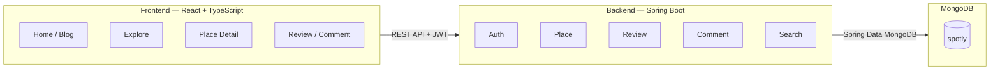

# 🏷️ Spotly — Nền tảng đánh giá và khám phá địa điểm

> **Spotly** là nền tảng web cho phép người dùng khám phá, tìm kiếm và đánh giá các địa điểm ăn uống, du lịch theo khu vực. Hệ thống hỗ trợ tạo địa điểm, viết review, chấm điểm, hình ảnh, bình luận/reply và tìm kiếm địa điểm.

---

## 📑 Mục Lục

* [1. Kiến Trúc & Công Nghệ](#1-kiến-trúc--công-nghệ)
* [2. Cấu Trúc Thư Mục](#2-cấu-trúc-thư-mục)
* [3. Tính Năng Nổi Bật](#3-tính-năng-nổi-bật)
* [4. Yêu Cầu Môi Trường](#4-yêu-cầu-môi-trường)
* [5. Hướng Dẫn Cài Đặt & Khởi Chạy](#5-hướng-dẫn-cài-đặt--khởi-chạy)
* [6. Tài Khoản Thử Nghiệm Mẫu](#6-tài-khoản-thử-nghiệm-mẫu)
* [7. Danh Sách API Backend (v1)](#7-danh-sách-api-backend-v1)
* [8. Ghi Chú Phát Triển](#8-ghi-chú-phát-triển)
* [9. Phân Công Thành Viên](#9-phân-công-thành-viên)
* [10. Kế Hoạch Phát Triển](#10-kế-hoạch-phát-triển)

---

# 1. Kiến Trúc & Công Nghệ



### Backend

* **Project**: Spotly Backend
* **Java**: 21 LTS
* **Framework**: Spring Boot
* **Build Tool**: Maven
* **Database Driver**: Spring Data MongoDB
* **API**: RESTful API
* **API Documentation & Testing**: Swagger / OpenAPI
* **Authentication**: JWT
* **Architecture**: Modular Monolith + Layered Architecture

### Frontend

* **React**
* **TypeScript**
* **Vite**
* **Tailwind CSS** hoặc Bootstrap

### Database

* **MongoDB**
* **MongoDB Compass**
* **Database**: `spotly`

### Công cụ phát triển

* IntelliJ IDEA / VS Code
* Swagger UI
* MongoDB Compass
* Git / GitHub
* k6

---

# 2. Cấu Trúc Thư Mục

```text
spotly/
│
├── backend/
│   ├── src/
│   │   ├── main/
│   │   │   ├── java/
│   │   │   │   └── com/spotly/
│   │   │   │       │
│   │   │   │       ├── common/
│   │   │   │       │   ├── config/
│   │   │   │       │   ├── exception/
│   │   │   │       │   └── response/
│   │   │   │       │
│   │   │   │       ├── auth/
│   │   │   │       │   ├── controller/
│   │   │   │       │   ├── service/
│   │   │   │       │   ├── repository/
│   │   │   │       │   ├── document/
│   │   │   │       │   └── dto/
│   │   │   │       │
│   │   │   │       ├── user/
│   │   │   │       ├── category/
│   │   │   │       │
│   │   │   │       └── place/
│   │   │   │           ├── controller/
│   │   │   │           ├── service/
│   │   │   │           ├── repository/
│   │   │   │           ├── document/
│   │   │   │           └── dto/
│   │   │   │
│   │   │   └── resources/
│   │   │       ├── application.yml
│   │   │       └── seed/
│   │   │           ├── users.json
│   │   │           ├── categories.json
│   │   │           └── places.json
│   │   │
│   │   └── test/
│   │
│   └── pom.xml
│
├── frontend/
│   ├── src/
│   │   ├── components/
│   │   ├── layouts/
│   │   ├── pages/
│   │   │   ├── Home/
│   │   │   ├── Explore/
│   │   │   ├── PlaceDetail/
│   │   │   ├── CreatePlace/
│   │   │   ├── WriteReview/
│   │   │   └── Auth/
│   │   ├── services/
│   │   ├── hooks/
│   │   ├── types/
│   │   └── utils/
│   │
│   ├── public/
│   ├── package.json
│   └── vite.config.ts
│
├── db/
│   ├── seed/
│   │   ├── users.json
│   │   ├── categories.json
│   │   └── places.json
│   │
│   └── scripts/
│       ├── create-indexes.js
│       └── seed-database.js
│
├── docs/
│   ├── database-design.md
│   ├── api.md
│   └── development-plan.md
│
└── README.md
```

---

# 3. Tính Năng Nổi Bật

## 🟢 1. Khám Phá Địa Điểm

### Trang Home / Blog

* Địa điểm nổi bật.
* Địa điểm được đánh giá cao.
* Review mới nhất.
* Địa điểm mới được thêm.
* Khám phá theo khu vực.
* Danh mục ăn uống / du lịch.

### Browse theo khu vực

```text
TP.HCM
│
├── Quận 1
├── Quận 3
├── Quận 5
├── Bình Thạnh
├── Tân Bình
├── Phú Nhuận
└── ...
```

Người dùng có thể:

* Chọn thành phố.
* Chọn quận/huyện.
* Xem danh sách địa điểm.
* Lọc theo category.
* Sắp xếp theo rating.
* Sắp xếp theo số lượng review.

---

## 🔎 2. Tìm Kiếm Địa Điểm

Người dùng có thể tìm kiếm:

* Tên địa điểm.
* Từ khóa.
* Thành phố.
* Quận/huyện.
* Loại địa điểm.

Ví dụ:

```text
"coffee quận 1"
"nhà hàng quận 5"
"du lịch Đà Lạt"
```

API:

```http
GET /api/v1/places/search?q=coffee
```

---

## 📍 3. Tìm Địa Điểm Gần Đây

Người dùng cung cấp:

```text
latitude
longitude
```

Hệ thống trả về các địa điểm gần vị trí đó.

```text
Vị trí
  ↓
Bán kính tìm kiếm
  ↓
Danh sách địa điểm
```

Sử dụng:

```text
2dsphere Index
```

---

## 🏪 4. Quản Lý Địa Điểm

Người dùng có thể tạo địa điểm mới.

Thông tin:

* Tên địa điểm.
* Category.
* Thành phố.
* Quận/huyện.
* Địa chỉ.
* Mô tả.
* Hình ảnh.
* Latitude.
* Longitude.

Luồng:

```text
Create Place
     ↓
Nhập thông tin
     ↓
Submit
     ↓
Place Detail
```

---

## ⭐ 5. Review & Rating

Người dùng có thể review một địa điểm.

Thông tin:

* Rating 1–5 sao.
* Nội dung review.
* Hình ảnh.
* Người đăng.
* Thời gian đăng.

Luồng:

```text
Place Detail
     ↓
Write Review
     ↓
Rating + Content + Images
     ↓
Submit
```

Sau khi review:

```text
ratingAverage
reviewCount
```

được cập nhật.

---

## 💬 6. Comment & Reply

Người dùng có thể:

* Comment vào review.
* Reply comment.
* Chỉnh sửa comment của mình.
* Xóa comment của mình.

```text
Review
│
├── Comment A
│   ├── Reply A1
│   └── Reply A2
│
├── Comment B
│
└── Comment C
```

---

## 📸 7. Hình Ảnh

Hỗ trợ hình ảnh cho:

* Địa điểm.
* Review.

Database lưu URL/metadata của hình ảnh.

---

## 📊 8. Rating Aggregation

Khi có review mới:

```text
Review mới
    ↓
Add vào reviews[]
    ↓
Aggregation Pipeline
    ↓
Tính reviewCount
    ↓
Tính ratingAverage
    ↓
Update Place
```

Ví dụ:

```text
Before

Rating: 4.20
Reviews: 10

       ↓ + 5★ Review

After

Rating: 4.27
Reviews: 11
```

---

## 🏆 9. Top Địa Điểm

Hiển thị Top 10 địa điểm.

Tiêu chí:

```text
ratingAverage DESC
reviewCount DESC
```

API:

```http
GET /api/v1/places/top
```

---

# 4. Yêu Cầu Môi Trường

Cần chuẩn bị:

* **Java**: 21 LTS trở lên.
* **Maven**: 3.9+.
* **Node.js**: 20+.
* **npm**: đi kèm Node.js.
* **MongoDB**: 8.x.
* **MongoDB Compass**.
* **Git**.
* **Swagger UI**.
* **k6**.

Kiểm tra:

```bash
java -version
mvn -version
node -v
npm -v
mongosh --version
```

---

# 5. Hướng Dẫn Cài Đặt & Khởi Chạy

## Bước 1: Clone project

```bash
git clone [REPOSITORY_URL]

cd spotly
```

---

## Bước 2: Cấu hình MongoDB

Khởi động MongoDB.

Database:

```text
spotly
```

MongoDB sẽ tạo collection khi ứng dụng thực hiện thao tác tương ứng.

---

## Bước 3: Cấu hình Backend

Tạo/cấu hình:

```text
backend/src/main/resources/application.yml
```

Ví dụ:

```yaml
spring:
  data:
    mongodb:
      uri: mongodb://localhost:27017/spotly

server:
  port: 8080
```

---

## Bước 4: Chạy Backend

```bash
cd backend

mvn clean install

mvn spring-boot:run
```

Backend:

```text
http://localhost:8080
```

Health check:

```text
http://localhost:8080/api/v1/health
```

Swagger UI:

```text
http://localhost:8080/swagger-ui/index.html
```

OpenAPI JSON:

```text
http://localhost:8080/v3/api-docs
```

---

## Bước 5: Tạo MongoDB Index

Chạy:

```bash
mongosh spotly db/scripts/create-indexes.js
```

Các index chính:

```text
Text Index
Compound Index
2dsphere Index
```

---

## Bước 6: Import Dummy Data

Dữ liệu demo:

```text
100 Places
5–15 Reviews / Place
300–500 Comments / Replies
```

Chạy:

```bash
mongosh spotly db/scripts/seed-database.js
```

Hoặc import trực tiếp bằng MongoDB Compass.

---

## Bước 7: Chạy Frontend

```bash
cd frontend

npm install

npm run dev
```

Frontend:

```text
http://localhost:5173
```

---

# 6. Tài Khoản Thử Nghiệm Mẫu

| Vai trò | Email            | Mật khẩu | Chức năng                     |
| ------- | ---------------- | -------- | ----------------------------- |
| User    | `user@test.com`  | `123456` | Review, comment, tạo địa điểm |
| Admin   | `admin@test.com` | `123456` | Quản lý hệ thống              |
| Demo    | `demo@test.com`  | `123456` | Tài khoản demo                |

> Tài khoản chỉ sử dụng trong môi trường development/demo.

---

# 7. Danh Sách API Backend (v1)

Tất cả API sử dụng prefix:

```text
/api/v1
```

API được mô tả và kiểm thử trực tiếp bằng **Swagger UI**.

Response chuẩn:

```json
{
  "success": true,
  "message": "Thao tác thành công",
  "data": {},
  "errors": null
}
```

## Health & Authentication

| Method | Endpoint                | Quyền  | Mô tả                   |
| ------ | ----------------------- | ------ | ----------------------- |
| `GET`  | `/api/v1/health`        | Public | Kiểm tra API và DB      |
| `POST` | `/api/v1/auth/register` | Public | Đăng ký                 |
| `POST` | `/api/v1/auth/login`    | Public | Đăng nhập               |
| `POST` | `/api/v1/auth/logout`   | Auth   | Đăng xuất               |
| `GET`  | `/api/v1/auth/me`       | Auth   | Thông tin user hiện tại |

---

## Categories

| Method   | Endpoint                  | Quyền  | Mô tả              |
| -------- | ------------------------- | ------ | ------------------ |
| `GET`    | `/api/v1/categories`      | Public | Danh sách category |
| `GET`    | `/api/v1/categories/{id}` | Public | Chi tiết category  |
| `POST`   | `/api/v1/categories`      | Admin  | Tạo category       |
| `PUT`    | `/api/v1/categories/{id}` | Admin  | Cập nhật category  |
| `DELETE` | `/api/v1/categories/{id}` | Admin  | Xóa category       |

---

## Places

| Method   | Endpoint              | Quyền       | Mô tả              |
| -------- | --------------------- | ----------- | ------------------ |
| `GET`    | `/api/v1/places`      | Public      | Danh sách địa điểm |
| `GET`    | `/api/v1/places/{id}` | Public      | Chi tiết địa điểm  |
| `POST`   | `/api/v1/places`      | Auth        | Tạo địa điểm       |
| `PUT`    | `/api/v1/places/{id}` | Owner/Admin | Cập nhật địa điểm  |
| `DELETE` | `/api/v1/places/{id}` | Owner/Admin | Xóa địa điểm       |

### Filter

```http
GET /api/v1/places?city=TPHCM

GET /api/v1/places?city=TPHCM&district=Quan1

GET /api/v1/places?category=restaurant

GET /api/v1/places?sort=rating
```

---

## Search

| Method | Endpoint                            | Quyền  | Mô tả                   |
| ------ | ----------------------------------- | ------ | ----------------------- |
| `GET`  | `/api/v1/places/search?q={keyword}` | Public | Tìm kiếm địa điểm       |
| `GET`  | `/api/v1/places/nearby`             | Public | Tìm địa điểm gần vị trí |
| `GET`  | `/api/v1/places/top`                | Public | Top địa điểm            |

---

## Reviews

| Method   | Endpoint                                      | Quyền  | Mô tả            |
| -------- | --------------------------------------------- | ------ | ---------------- |
| `GET`    | `/api/v1/places/{placeId}/reviews`            | Public | Danh sách review |
| `POST`   | `/api/v1/places/{placeId}/reviews`            | Auth   | Tạo review       |
| `PUT`    | `/api/v1/places/{placeId}/reviews/{reviewId}` | Owner  | Sửa review       |
| `DELETE` | `/api/v1/places/{placeId}/reviews/{reviewId}` | Owner  | Xóa review       |

---

## Comments

| Method   | Endpoint                                                           | Quyền | Mô tả       |
| -------- | ------------------------------------------------------------------ | ----- | ----------- |
| `POST`   | `/api/v1/places/{placeId}/reviews/{reviewId}/comments`             | Auth  | Tạo comment |
| `PUT`    | `/api/v1/places/{placeId}/reviews/{reviewId}/comments/{commentId}` | Owner | Sửa comment |
| `DELETE` | `/api/v1/places/{placeId}/reviews/{reviewId}/comments/{commentId}` | Owner | Xóa comment |

Reply:

```json
{
  "content": "Mình cũng thấy quán này ngon.",
  "parentCommentId": "comment_001"
}
```

---

# 8. Ghi Chú Phát Triển

## Coding Convention

### Backend

* Java naming convention.
* Class: `PascalCase`.
* Method/variable: `camelCase`.
* DTO: `Request` / `Response`.
* Không đặt business logic trong Controller.
* Repository sử dụng Spring Data MongoDB.

Ví dụ:

```text
PlaceController
PlaceService
PlaceRepository
PlaceDocument
CreatePlaceRequest
PlaceResponse
```

### Frontend

* TypeScript.
* ESLint.
* Prettier.
* Component: `PascalCase`.
* Function/variable: `camelCase`.

---

## Git Branch

```text
main
develop
feature/...
fix/...
```

Ví dụ:

```text
feature/place-crud
feature/review
feature/search-index
feature/aggregation-rating
feature/frontend-explore
```

---

## Commit Convention

```text
feat: add place CRUD
feat: add review API
feat: add text search
feat: add rating aggregation

fix: fix review calculation
fix: fix place search

refactor: restructure place module

docs: update README
```

---

## API Testing

Không sử dụng Postman làm công cụ chính.

Tất cả API trong quá trình phát triển được kiểm tra bằng **Swagger UI**:

```text
http://localhost:8080/swagger-ui/index.html
```

Quy trình:

```text
Code API
   ↓
Run Backend
   ↓
Swagger UI
   ↓
Test Request
   ↓
Check Response
   ↓
Check MongoDB Compass
```

Đối với các chức năng MongoDB:

```text
Swagger
   ↓
API Request
   ↓
MongoDB
   ↓
MongoDB Compass
```

---

## Quy Tắc Phát Triển

1. Không commit trực tiếp vào `main`.
2. Mỗi feature tạo branch riêng.
3. Test API bằng Swagger trước khi tích hợp frontend.
4. Kiểm tra MongoDB bằng Compass đối với các chức năng database quan trọng.
5. Không hard-code MongoDB connection string.
6. Không commit `.env`.
7. Không lưu binary image trực tiếp trong Place Document.
8. Không thêm framework/library mới nếu chưa thống nhất trong nhóm.

---

# 9. Phân Công Thành Viên

## 👨‍💻 SV1 — Data Architect & CRUD Lead

### Backend

* [ ] Project setup.
* [ ] MongoDB configuration.
* [ ] User.
* [ ] Authentication.
* [ ] Category CRUD.
* [ ] Place CRUD.
* [ ] Review CRUD.
* [ ] Comment CRUD.

### Database

* [ ] Place Document.
* [ ] Embedded Reviews.
* [ ] Embedded Comments.
* [ ] Embedded Replies.
* [ ] Seed data.

### Demo

```text
Swagger
   ↓
POST Review
   ↓
MongoDB Compass
   ↓
reviews[] updated
```

---

## 👨‍💻 SV2 — Advanced Query Specialist

### MongoDB

* [ ] Text Index.
* [ ] Compound Index.
* [ ] 2dsphere Index.
* [ ] Aggregation Pipeline.
* [ ] Rating Average.
* [ ] Review Count.
* [ ] Top Places.
* [ ] Nearby Search.
* [ ] Explain Query.

### Backend API

* [ ] Search API.
* [ ] Nearby API.
* [ ] Top Places API.
* [ ] Aggregation logic.

### Demo

```text
Swagger
   ↓
New Review
   ↓
Aggregation
   ↓
ratingAverage
reviewCount
```

---

## 👨‍💻 SV3 — Fullstack Integrator & DB Tester

### Frontend

* [ ] Home / Blog.
* [ ] Explore.
* [ ] Browse theo khu vực.
* [ ] Place Detail.
* [ ] Create Place.
* [ ] Write Review.
* [ ] Comment.
* [ ] Search.

### Testing

* [ ] Swagger API testing.
* [ ] MongoDB Compass.
* [ ] Seed data.
* [ ] k6 performance test.
* [ ] Integration testing.

---

# 10. Kế Hoạch Phát Triển

## Phase 1 — Setup

* [ ] Tạo Git repository.
* [ ] Setup Java 21 + Spring Boot.
* [ ] Setup React + TypeScript.
* [ ] Setup MongoDB.
* [ ] Setup Swagger.
* [ ] Tạo project structure.

---

## Phase 2 — Database & Backend Core

* [ ] User.
* [ ] Authentication.
* [ ] Category.
* [ ] Place.
* [ ] MongoDB Document.
* [ ] Seed data.

---

## Phase 3 — Review System

* [ ] Create Review.
* [ ] Update Review.
* [ ] Delete Review.
* [ ] Rating.
* [ ] Comment.
* [ ] Reply.
* [ ] Embedded Review.

---

## Phase 4 — Advanced MongoDB

* [ ] Text Index.
* [ ] Compound Index.
* [ ] 2dsphere Index.
* [ ] Search.
* [ ] Nearby Search.
* [ ] Aggregation.
* [ ] Rating Average.
* [ ] Review Count.
* [ ] Top Places.

---

## Phase 5 — Frontend

* [ ] Home.
* [ ] Blog / Explore.
* [ ] Browse khu vực.
* [ ] Search.
* [ ] Place Detail.
* [ ] Create Place.
* [ ] Write Review.
* [ ] Comment / Reply.

---

## Phase 6 — Data & Testing

* [ ] 50–100 Places.
* [ ] 5–15 Reviews / Place.
* [ ] 300–500 Comments / Replies.
* [ ] Test toàn bộ API bằng Swagger.
* [ ] Kiểm tra document bằng Compass.
* [ ] Test Index.
* [ ] Test Aggregation.
* [ ] Test performance bằng k6.

---

## Phase 7 — Demo & Report

### Demo Flow

```text
1. Home / Blog
       ↓
2. Chọn TP.HCM
       ↓
3. Chọn Quận 1
       ↓
4. Chọn một địa điểm
       ↓
5. Xem Review
       ↓
6. Swagger → POST Review
       ↓
7. MongoDB Compass → kiểm tra reviews[]
       ↓
8. Website → ratingAverage thay đổi
       ↓
9. Swagger → Search
       ↓
10. MongoDB → kiểm tra Index
       ↓
11. Nearby Search
       ↓
12. Top Places
```

### Barem cần đảm bảo

| Hạng mục | Nội dung                                  |
| -------- | ----------------------------------------- |
| **2.5đ** | Database design + Embedded Document       |
| **2.5đ** | CRUD Place / Review / Comment / Rating    |
| **2.5đ** | Text Index + Compound Index + Aggregation |
| **2.5đ** | Dummy data + Performance + Demo           |

---

# 🤝 Đóng Góp & Phát Triển

**Spotly** được phát triển bởi nhóm 3 thành viên.

Mọi thay đổi cần được phát triển trên branch riêng và kiểm tra API bằng Swagger trước khi merge vào `develop`.

```text
feature branch
      ↓
Development
      ↓
Swagger Testing
      ↓
MongoDB Compass Check
      ↓
Code Review
      ↓
develop
      ↓
main
```
